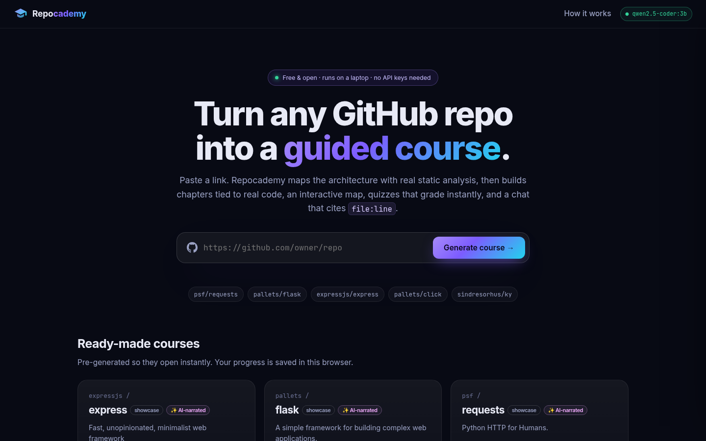
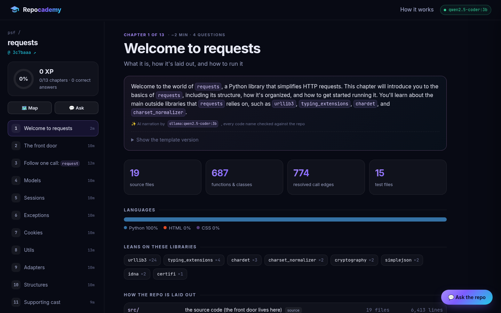
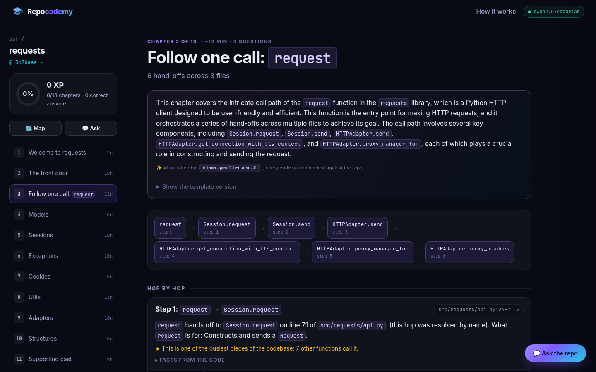
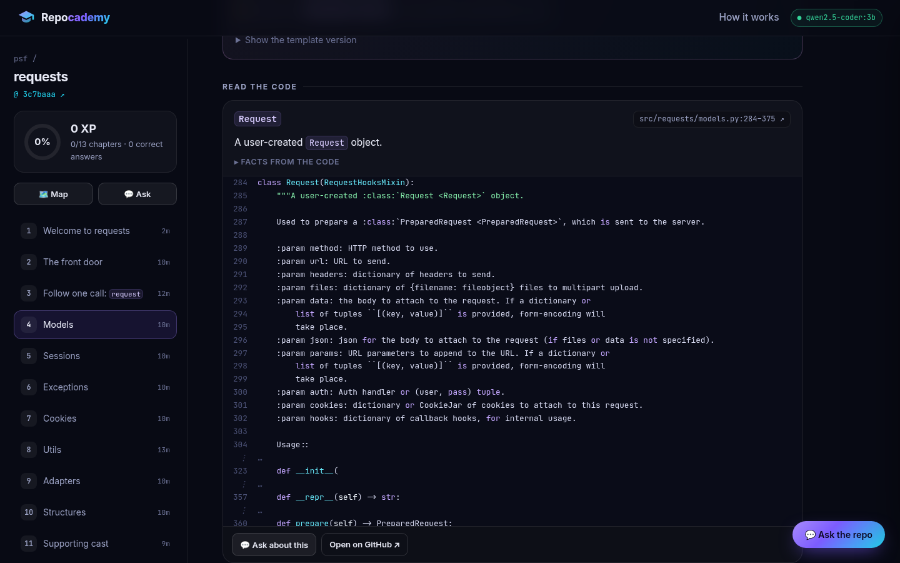
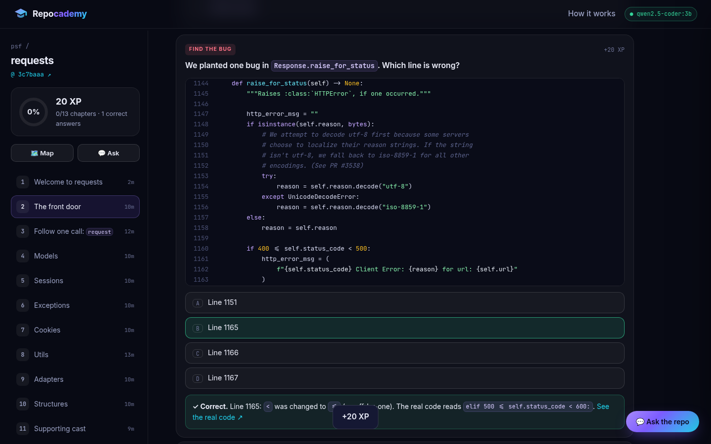
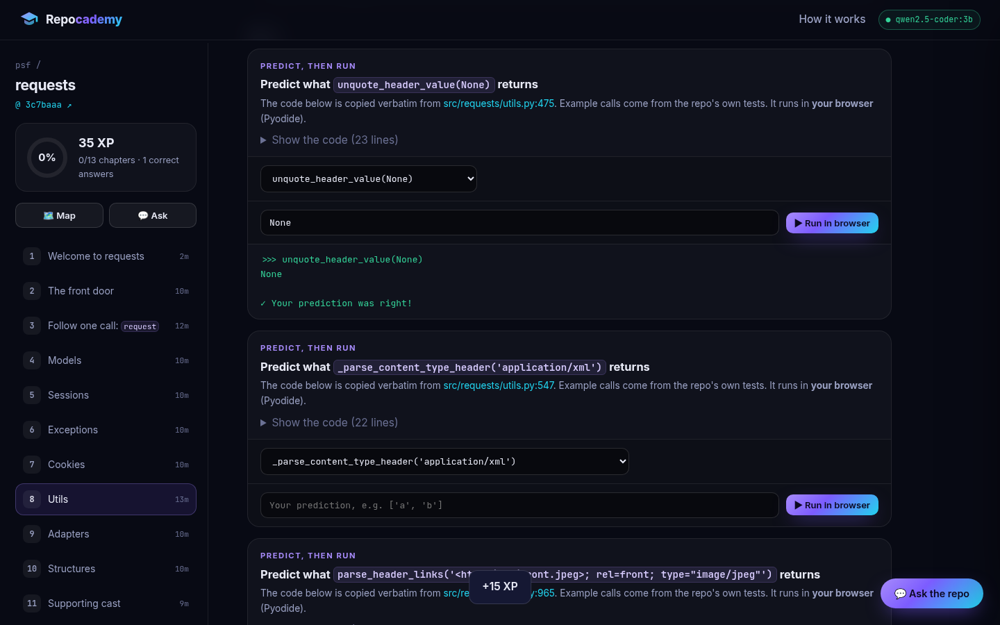
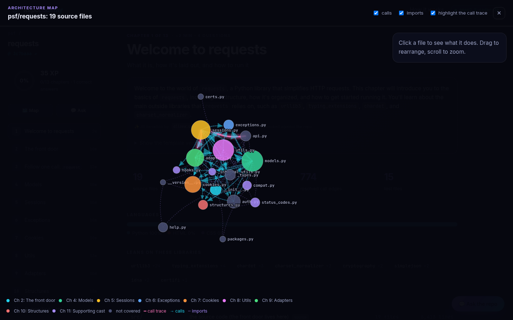
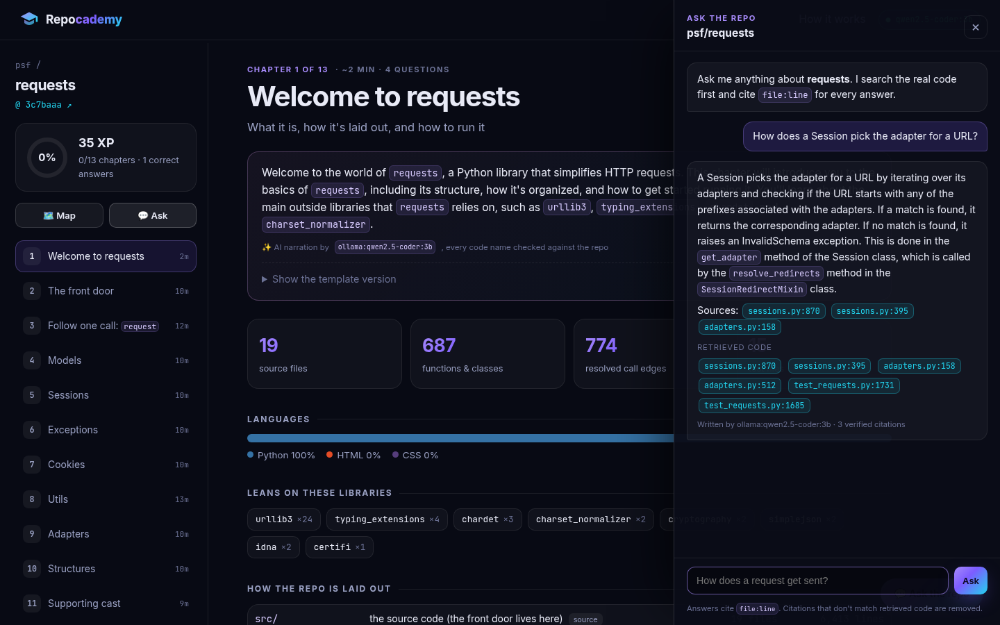

# Repocademy

**Paste a GitHub link. Get a guided course on that codebase in seconds.**

Repocademy turns any public GitHub repository into an interactive course: chapters that walk you
through the real code, a live architecture map, a "follow one call" trace through the system,
quizzes that grade instantly (including *find the bug we planted*), small exercises you run in the
browser, and an "ask the repo" chat that answers with `file:line` citations.

It runs entirely on free, local tools. The structure of every course comes from deterministic
static analysis, not from a language model, so a small local model can't make the course wrong.
A model only writes the optional chapter intros and the chat answers. Both are checked against
the repository before you see them.



## Why

Opening a big codebase is a common way to get stuck. Before you can contribute, you need answers:
where to start reading, what calls what, and which file handles what. READMEs explain how to *use*
a project, not how it's *built*. Repocademy gives you the same orientation a senior teammate would,
for any public repo, for free.

## What you get

| | |
|---|---|
|  | **Overview**: languages, size, layout, outside libraries, how to run it, and quiz warm-ups. |
|  | **Follow one call**: a real path through the code (for requests: `get → request → Session.request → Session.send → HTTPAdapter.send …`), each hop shown at the exact line where it happens. |
|  | **Chapters tied to real code**: every section is a real excerpt with line numbers, a link to that exact commit on GitHub, its callers and callees, and an "Ask about this" button. |
|  | **Quizzes that grade instantly**: multiple choice ("which file handles X?", "what does Y call?"), order the call path, find the hand-off line, and *find the bug*: we plant one realistic mutation in a real function. |
|  | **Try it**: pure functions are extracted with their constants and helpers. You predict the output, then run it in your browser (Pyodide for Python, a Web Worker for JS). Example inputs come from the project's own tests and doctests. |
|  | **Architecture map**: every source file sized by lines and coloured by chapter. Toggle call and import edges, highlight the traced path, and click a file to jump to its chapter. |
|  | **Ask the repo**: BM25 retrieval over symbol-level chunks, then a local model answers with citations. Any citation that doesn't point inside the retrieved code is removed. |

Progress, XP and quiz answers are saved in your browser (localStorage). No account is needed.

## How it works

```
github URL ─▶ shallow clone ─▶ scan ─▶ parse (Python ast / tree-sitter JS+TS)
            ─▶ graph: imports, calls, inheritance, PageRank over symbols and modules
            ─▶ planner: chapters, sections, trace, quizzes, exercises (deterministic)
            ─▶ course.json + retrieval index        (cached per commit)
            ─▶ optional: narration by a local model (fact-checked, falls back to templates)
```

* **Static analysis** (`repocademy/py_analyzer.py`, `js_analyzer.py`, `graph.py`): resolves Python
  dotted/relative imports and `src/` layouts, JS `require`/`import`, re-export chains and
  `module.exports = …`. Calls are resolved through `self`/`this`/`super`, imported names,
  `module.attr`, inherited methods, and a few clearly marked weak heuristics. Calls inside
  `except`/`catch` blocks are tagged as error paths, so the trace follows the happy path.
* **Planner** (`planner.py`): picks the public API ("front door"), the most central modules,
  a call path worth tracing, the test layout and next steps (TODOs, big functions, undocumented
  code). Quizzes are generated from graph facts, so every answer is checkable.
* **Bug quizzes** (`quiz.py`): mutations such as `==`→`!=`, `<`→`<=`, `and`→`or`, `is None`→`is not None`,
  a dropped `not`, or `+ 1`→`- 1`, applied to a condition or `return` line. They only apply to code lines (never docstrings, comments or strings), and
  mutated Python must still parse.
* **Exercises** (`exercises.py`): only functions that use the standard library, module constants
  and other pure helpers, called with literal arguments taken from the project's tests
  (including expanded `pytest.mark.parametrize`) or doctests. They run **only in the learner's
  browser**. The server never executes code from the repository.
* **Grounded AI** (`narrate.py`, `ask.py`): the model only sees facts and code excerpts we
  extracted. A narration is rejected if it names anything (in backticks) that isn't in the
  repository, and the template stays. Chat citations are checked against the retrieved chunks.

## Run it

Requirements: Python 3.10+, git. Optional: [Ollama](https://ollama.com) for AI narration and chat.

```bash
make setup                     # creates .venv and installs requirements-dev.txt
make dev                       # http://127.0.0.1:8800
make test                      # pytest
```

Optional local model (free, runs on CPU):

```bash
ollama pull qwen2.5-coder:3b   # or qwen2.5-coder:1.5b on smaller machines
```

Without a model everything still works: chapters use templates, and the chat returns the most
relevant code with links instead of a written answer.

### Configuration

| Variable | Default | Meaning |
|---|---|---|
| `REPOCADEMY_DATA` | `./cache` | Where clones and built courses are stored |
| `REPOCADEMY_OLLAMA_URL` | `http://127.0.0.1:11434` | Ollama server |
| `REPOCADEMY_OLLAMA_MODEL` | first available of `qwen2.5-coder:3b`, `qwen2.5-coder:1.5b`, `qwen2.5:1.5b`, … | Chat model |
| `REPOCADEMY_NARRATE_MODEL` | same as chat | Model for chapter intros |
| `REPOCADEMY_LLM_BASE_URL`, `REPOCADEMY_LLM_API_KEY`, `REPOCADEMY_LLM_MODEL` | unset | Any OpenAI-compatible endpoint (for example a free tier). Falls back to Ollama, then templates. |
| `REPOCADEMY_LLM` | on | `off` = never call a model |
| `REPOCADEMY_AUTO_NARRATE` | `1` | Narrate new courses in the background after building |

### Showcase courses

`showcase/` ships pre-built courses for **psf/requests**, **pallets/flask** and **expressjs/express**
(chapter intros written by `qwen2.5-coder:3b` and fact-checked), so a demo opens instantly. Rebuild them with `make showcase` (needs network).

## Safety

* Only `https://github.com/<owner>/<repo>` URLs are accepted. Clones are shallow, with
  `core.symlinks=false`, hooks disabled, `protocol.file.allow=never`, no submodules, no LFS
  downloads and a 400 MB cap.
* The scanner never follows symlinks and never reads outside the checkout.
* No repository code runs on the server. Exercises run in the learner's browser sandbox.
* The chat and narration prompts contain only extracted text, and model output is shown as escaped text.

## Limitations (honest)

* Supports Python, JavaScript and TypeScript. Other languages show up in stats but get no chapters.
* Call resolution is static and heuristic. Dynamic dispatch (plugin registries, `getattr`,
  computed property names) is missed, and some edges are guesses (matched by name). In the trace, those
  hops are labelled "resolved by name". On some JS codebases the trace picks a less interesting path.
* Exercises only exist where a function is pure and the tests call it with literal arguments,
  so some repos get one or none.
* Small local models (1.5B–3B) write decent intros but sometimes answer chat questions vaguely.
  Citations are verified, but the prose is not.
* Python exercises need internet on first use to load Pyodide from the CDN.

## Project layout

```
repocademy/   analysis, planner, quizzes, exercises, retrieval, LLM glue
app/          FastAPI server + static single-page UI (vanilla JS, D3, highlight.js)
showcase/     pre-built demo courses
scripts/      build_showcase.py, screenshots.py
tests/        pytest suite on tiny fixture repos (no network)
docs/         demo script, Devpost write-up, screenshots
```

## License

MIT. See [LICENSE](LICENSE) and [THIRD_PARTY_NOTICES.md](THIRD_PARTY_NOTICES.md).
